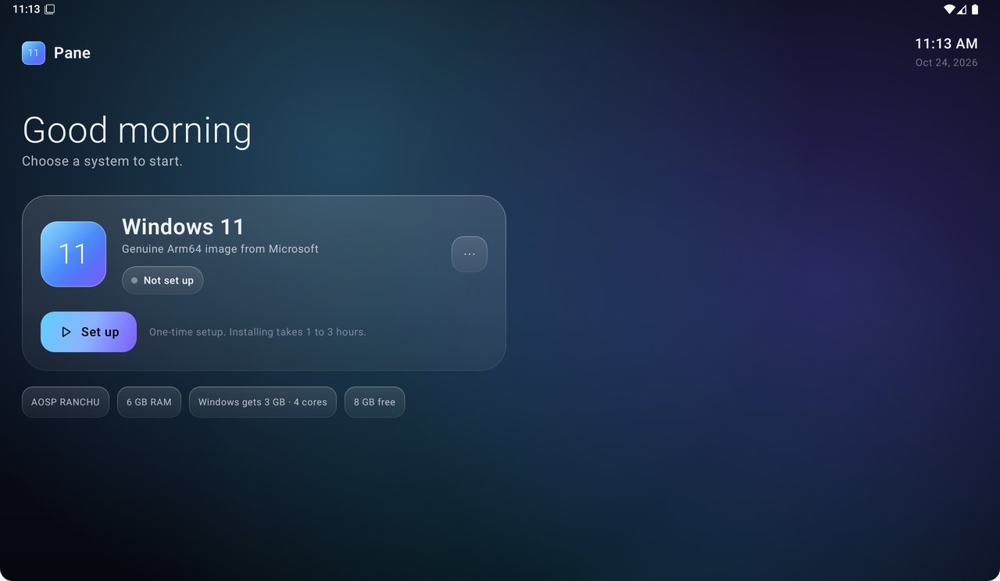
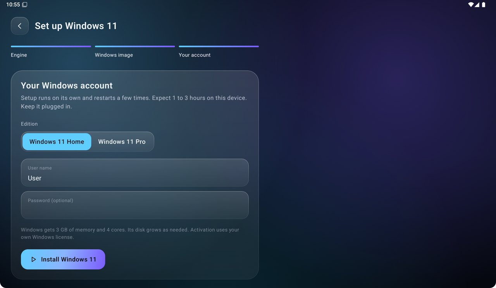
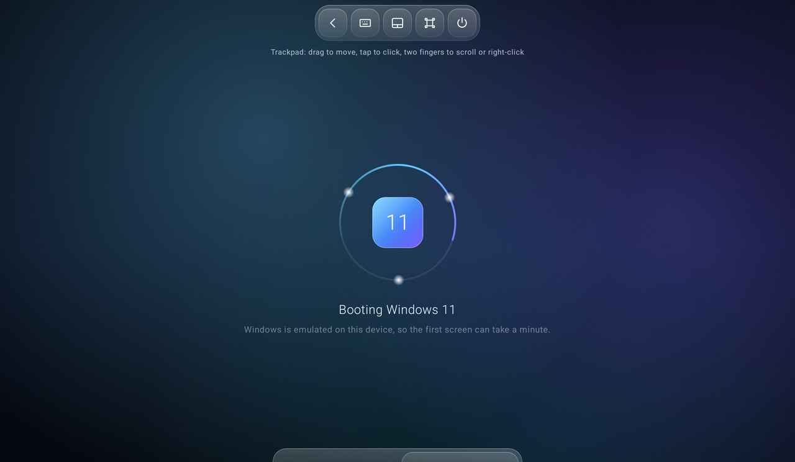
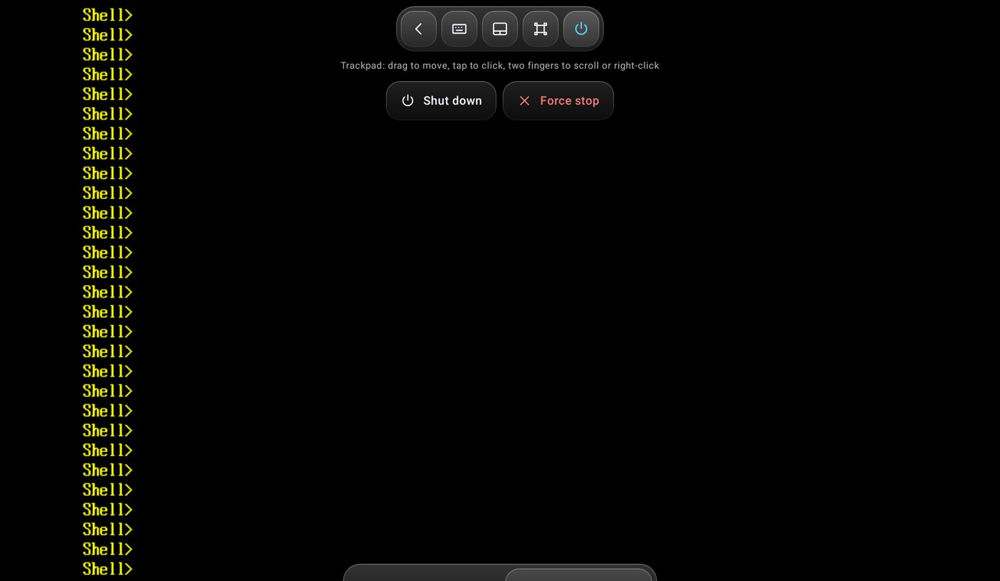

# Pane

Genuine Windows 11 on an Android phone or tablet, in one app. Open Pane, pick Windows 11, and it boots. No root, no PC, no dual boot.



| Setup | Boot | Controls |
|---|---|---|
|  |  |  |

## Read this first: speed

Phones don't let apps use hardware virtualization. That includes the Snapdragon 8 Gen 2 and the Helio G99. Pane therefore emulates the CPU in software (QEMU TCG), and Windows runs slowly:

- Setup takes hours, once. Linaro measured 1 to 2 hours on a high-end PC with the same method; a phone is slower.
- Booting takes minutes, every click lags, and animations inside Windows stutter.
- A faster phone helps a lot. A Snapdragon 8 Gen 2 or better is recommended. A Helio G99 works, but more slowly.

v0.1.0 is tested on the Android emulator: engine install, VM creation, UEFI boot, display, keyboard and power controls all work. A full Windows install on a real phone has **not** been tested yet.

## What you need

- Android 8 or newer, 64-bit ARM. 8 GB of RAM or more.
- About 35 GB free: 6 GB for the ISO, 20 to 30 GB for Windows.
- The official [Windows 11 Arm64 ISO](https://www.microsoft.com/software-download/windows11arm64) from Microsoft. Activating Windows uses your own license.
- Internet access for the one-time engine download (about 40 MB).

## Install

1. Download `Pane-0.1.0.apk` from [Releases](../../releases) and install it.
   Android may warn that the app targets an older Android version. That is on purpose: see [How it works](#how-it-works).
2. Open Pane, tap **Set up**, then **Download engine**.
3. Download the Windows 11 Arm64 ISO in your browser, keep it in Downloads, and pick it in Pane.
4. Choose Home or Pro and a user name, then tap **Install Windows 11**. Keep the device plugged in.
   Setup runs by itself and restarts a few times.
5. When the Windows desktop appears, tap **I see the desktop**.

If Windows stops while you use other apps, open Developer options and turn on **Disable child process restrictions**. Android 12 and later limit long-running helper processes.

## Controls

| Input | How it works |
|---|---|
| Touch, trackpad mode (default) | Drag to move the pointer, tap to click, tap then drag to drag, two-finger tap or long press to right-click, two fingers to scroll |
| Touch, direct mode | Tap where you touch, drag to drag, long press to right-click |
| Pen | Points directly, hovering moves the pointer, the barrel button right-clicks |
| Keyboard | On-screen keyboard from the toolbar, or any hardware keyboard (US layout) |
| Special keys | Esc, Tab, Win, Ctrl, Alt, Shift (they stay held until the next key), arrows, Enter, Ctrl+Alt+Del |
| Mouse | Works as a PC mouse, including wheel and right-click |
| Gamepad | Left stick moves the pointer, right stick scrolls, A clicks, B right-clicks, Start opens Start, X is Esc, Y is Enter |

Tap the handle at the top to show the toolbar. It hides after a few seconds.

## Hardware support in v0.1.0

| Hardware | Status |
|---|---|
| Touch, pen, mouse, keyboard | Works, as a PC mouse and keyboard |
| Gamepad | Works, mapped to mouse and keys. Windows doesn't see a game controller |
| Sound out | Built (QEMU's VNC audio to Android AudioTrack), not yet tested with Windows |
| Network | Built (virtio-net with the bundled Arm64 NetKVM driver), not yet tested with Windows |
| Microphone | Not yet |
| Camera | Not yet |
| USB devices | Not yet |

## How it works

```
Pane (Kotlin, Jetpack Compose)
 └─ proot (Termux build, bundled)          runs Linux programs without root
     └─ Alpine Linux 3.24 (downloaded)
         └─ QEMU 11 qemu-system-aarch64    software CPU emulation (TCG, multi-threaded)
             └─ edk2 UEFI → Windows 11 Arm64
```

- **Display**: QEMU's VNC server on a private Unix socket. Pane's own VNC client draws it on a SurfaceView. Resolution is 1024x768, the most the stock ARM firmware offers for a framebuffer Windows can use without extra drivers.
- **Input**: VNC pointer events (a USB tablet in the guest) and QEMU's scancode key events.
- **Sound**: QEMU's VNC audio extension, played through AudioTrack.
- **Control**: QEMU's QMP socket, for shutting down and quitting.
- **Setup**: a generated `autounattend.xml` installs Windows unattended. It skips the TPM, Secure Boot and CPU checks QEMU can't meet, creates a local account, sets a US keyboard and your time zone. The Arm64 NetKVM network driver from virtio-win is added through `$WinPEDriver$`. Windows itself is left as Microsoft ships it.
- **Why it targets Android 9 (API 28)**: Android blocks apps that target API 29 or later from running programs they download, and QEMU is one. Termux and Vectras VM do the same.

## Build

Requires JDK 17+ and the Android SDK.

```bash
./gradlew assembleRelease
```

`scripts/fetch-proot.py` refreshes the bundled proot binaries from Termux's package repository.

## Credits and licenses

Pane is MIT licensed. It stands on:

- [QEMU](https://www.qemu.org) (GPL-2.0) and [edk2](https://github.com/tianocore/edk2) (BSD-2-Clause-Patent), downloaded at first run from [Alpine Linux](https://alpinelinux.org) packages.
- [proot](https://github.com/termux/proot) (GPL-2.0), [talloc](https://talloc.samba.org) (LGPL-3.0) and [libandroid-shmem](https://github.com/termux/libandroid-shmem) (BSD-3-Clause), Termux builds bundled in the APK. Their sources are attached to each release.
- The NetKVM Arm64 driver from [virtio-win](https://github.com/virtio-win/kvm-guest-drivers-windows) (BSD-3-Clause), bundled.
- [Vectras VM](https://github.com/xoureldeen/Vectras-VM-Android), whose approach (proot, Alpine, QEMU, API 28) Pane follows, and Linaro's notes on Windows Arm64 under QEMU.

Pane is not affiliated with Microsoft. Windows is a trademark of Microsoft Corporation.
